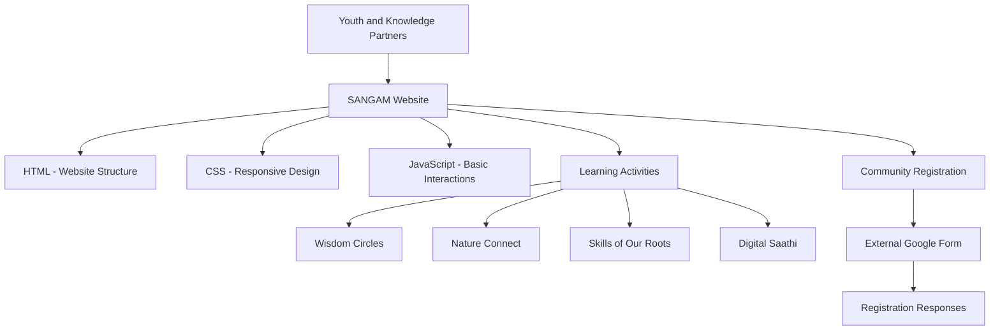

# SANGAM – System Architecture

## 1. Architecture Overview

SANGAM currently uses a simple client-side web architecture. Users access the website through a browser and explore its learning activities. Community registration is handled through an external Google Form.

## 2. Architecture Diagram

## 3. Main Components
	•	Users: Youth, elderly people, farmers, rural women, artisans and knowledge partners.
	•	Website Interface: Displays SANGAM’s purpose, activities and community information.
	•	HTML: Organises the website content.
	•	CSS: Provides styling and mobile responsiveness.
	•	JavaScript: Supports basic interactions.
	•	Google Forms: Collects community registration responses externally.

## 4. Working Flow
	1.	A participant visits the SANGAM website.
	2.	The participant explores the available learning activities.
	3.	The participant selects the community registration option.
	4.	The website opens the external Google Form.
	5.	The participant submits the registration details.
	6.	Responses are collected through Google Forms.

## 5. Current and Proposed Architecture

The current prototype includes the website interface, basic interactions and external registration.

Automated participant matching, user accounts, partner verification and an integrated feedback system are proposed future enhancements.

## 6. Architecture Goal

The architecture is designed to be simple, accessible and expandable. Future versions of SANGAM may introduce a backend, database and additional digital services to support a larger community.

